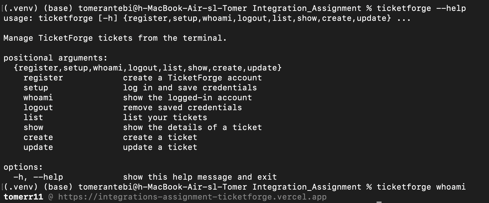
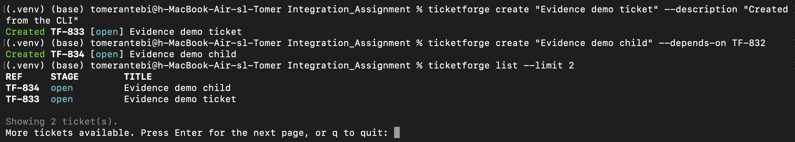
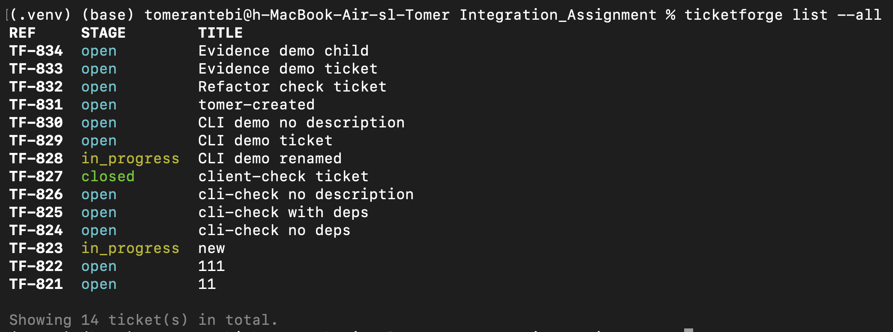
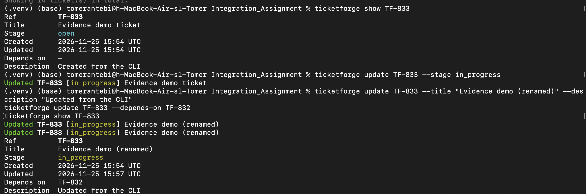
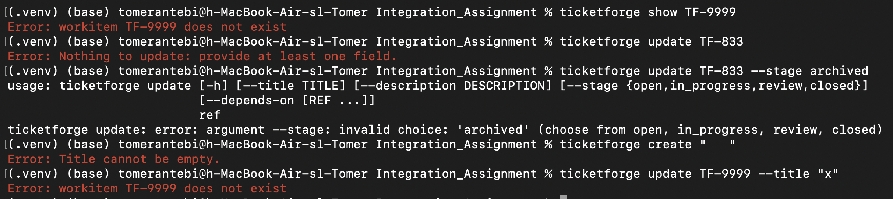

# TicketForge CLI

A small command line app to manage tickets in
[TicketForge](https://integrations-assignment-ticketforge.vercel.app) from the terminal.

TicketForge has no public API documentation, so the endpoints were reverse engineered from
the web app's network requests.

## Features
- `register`, `setup`, `whoami`, `logout`: create an account and manage saved credentials
- `create`, `list`, `show`, `update`: manage tickets
- Cursor-based pagination (interactive paging, or `--all`)
- Automatic retry when the API answers HTTP 429 (rate limit)
- Colored table output (plain text when piped, or when `NO_COLOR` is set)

## Install
Requires Python 3.11 or newer.

```bash
python3 -m venv .venv
source .venv/bin/activate
pip install -e .          # use ".[dev]" to also install pytest
```

This installs the `ticketforge` command.

## Usage
```bash
ticketforge register [--username NAME]    # create an account (prompts for what is missing)
ticketforge setup [--username NAME]       # log in and save the credentials
ticketforge whoami                   # show the saved account (never prints the password)

ticketforge create "Fix login bug" --description "500 on submit" --depends-on TF-12
ticketforge list                     # one page at a time, press Enter for the next page
ticketforge list --limit 3           # 1-5 tickets per page (the API maximum is 5)
ticketforge list --all               # every ticket in one table
ticketforge show TF-821              # full details of one ticket
ticketforge update TF-821 --stage in_progress
ticketforge update TF-821 --title "New title" --description "More detail"
ticketforge update TF-821 --depends-on TF-1 TF-2     # replace the dependencies
ticketforge update TF-821 --depends-on               # clear the dependencies

ticketforge logout                   # delete the saved credentials
```

Stages: `open`, `in_progress`, `review`, `closed`.

Credentials are saved in `~/.ticketforge/config.json` (file mode `0600`).
On any failure the command prints `Error: ...` to stderr and exits with code `1`.

## How it works
```
cli/         argparse commands and terminal output (wires the layers together, no HTTP of its own)
services/    ticket rules: validation, partial update, paging
client/      TicketClient and AccountClient, plus transport (HTTP, error mapping, 429 retry)
models/      API payload types and ticket objects
config/      saved settings
exceptions/  domain errors shared by every layer
```

Layers depend downward only. Tests use in-memory fakes instead of the network.

What the API taught me:
- Most failures come back as HTTP 400. The real type is in the JSON `err` code
  (`not_found`, `user_exists`, `invalid_cursor`, ...), so errors are mapped by code first.
- There is no login endpoint, so `setup` checks the credentials with one authenticated request.
- `PUT` rejects partial bodies, so `update` fetches the ticket first and only changes the fields you pass.
- Only the single-ticket endpoint returns `dependsOn`; the list endpoint omits it. That is why `show` exists.
- Listing uses an opaque `nextCursor`; offset and page parameters are silently ignored.

## Tests
```bash
pip install -e ".[dev]"
python -m pytest -q
```
81 tests cover models, error mapping, rate-limit retry, both clients, the service,
settings and the CLI, with positive and negative cases. No test uses the network.

## Evidence that it runs
All screenshots below are from a real run against the live TicketForge API.

### 1. Help and saved account
`ticketforge --help` lists every command, and `ticketforge whoami` shows the saved account
(the password is never printed).



### 2. Creating tickets and paged listing
Two tickets are created: `TF-833` with a description, and `TF-834` that depends on `TF-832`.
`ticketforge list --limit 2` then shows one page of two tickets and prompts for the next page.



### 3. Listing everything
`ticketforge list --all` follows the API cursor through every page and prints one aligned,
color-coded table with a total count (14 tickets).



### 4. Showing and updating a ticket
`show TF-833` is run first, then the ticket is updated three times: the stage, then the title and
description, then the dependency. The final `show TF-833` displays all the changes.
(The last two commands appear without a prompt because they were pasted together; both ran.)



### 5. Error handling
Unknown tickets, an update with no fields, an invalid stage and a blank title each produce a
clear message instead of a stack trace. Failures exit with code `1`.



## Assumptions and limitations
- `list` shows only the logged-in user's own tickets (`/workitems/mine`).
- The password is stored in plain text in the config file, protected only by its file permissions.
- Custom fields are not supported: `update` sends an empty `customFields` object.
- The API does not return a ticket owner, so none is shown.
- Only HTTP 429 is retried (up to 2 times, at most 60 seconds each). Timeouts and 5xx errors are
  not retried, so a repeated `create` can never produce duplicate tickets.
- `--limit` is not validated locally; the API caps it at 5.

## AI disclosure
I used AI tools (Cursor with Claude) while working on this assignment. They assisted with:
- writing and reviewing parts of the code, including refactoring and naming suggestions
- writing the pytest test suite
- adding the `show` command
- drafting this README

I reviewed the generated code, ran it against the real TicketForge API, and take
responsibility for the final result.
